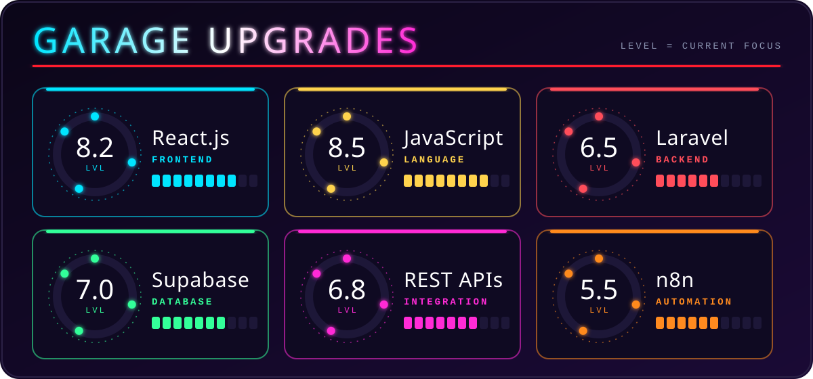

<h3 align="center">A Computer Science Student | Aspiring Full-Stack Developer from Indonesia</h3>

  

## 🏁 Driver License

  

- 🔭 I’m currently working on **Digital Guest Book System**

- 🌱 I’m currently learning **React.js, Laravel, Supabase, REST APIs, and Workflow Automation with n8n**

- 👯 I’m looking to collaborate on **Web Development Projects**

- 🤝 I’m looking for help with **Web Development Projects**

- 👨‍💻 All of my projects are available at [https://github.com/sukraalhamda](https://github.com/sukraalhamda)

- 💬 Ask me about **React.js, JavaScript, CRUD Applications, Supabase, and Web Development Projects**

- 📫 How to reach me **sukra.alhamda1308@gmail.com**

- ⚡ Fun fact **I learn best by building real-world projects and solving problems through code.**

## 🔧 Pit Wall

  

## 🏎️ Garage Upgrades

  

 

  

## 🗺️ Learning Circuit

  

<h3 align="left">Connect with me:</h3>

  
  

<h3 align="left">Languages and Tools:</h3>

                                      

  

